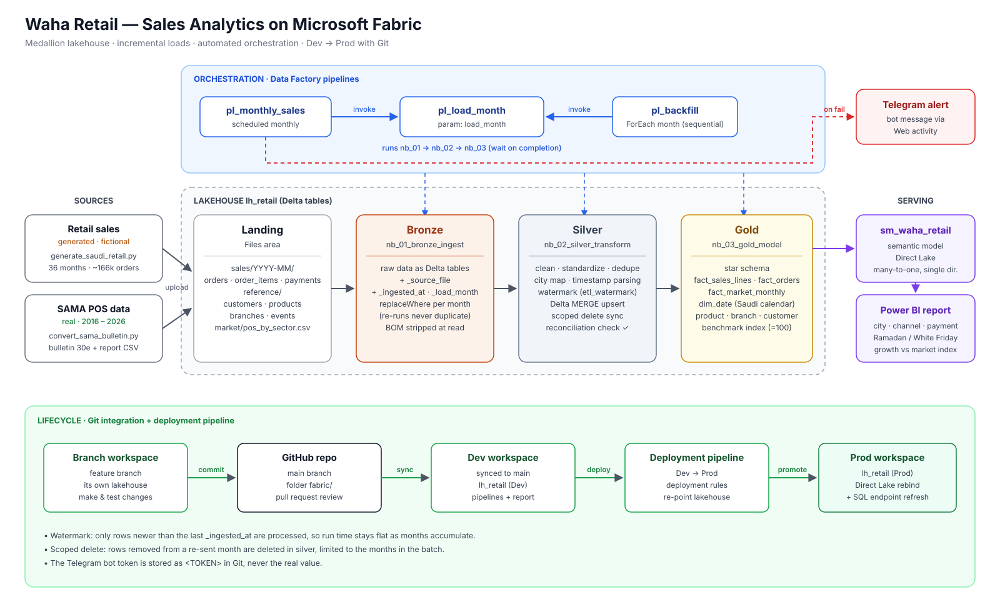
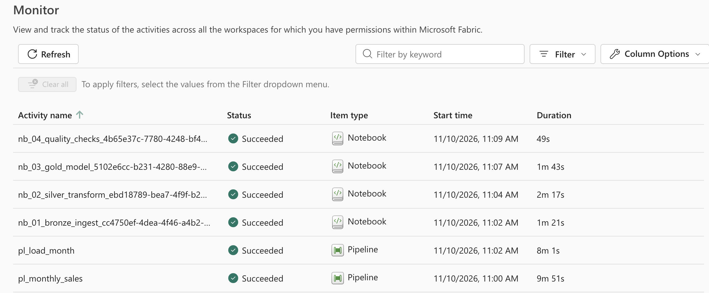
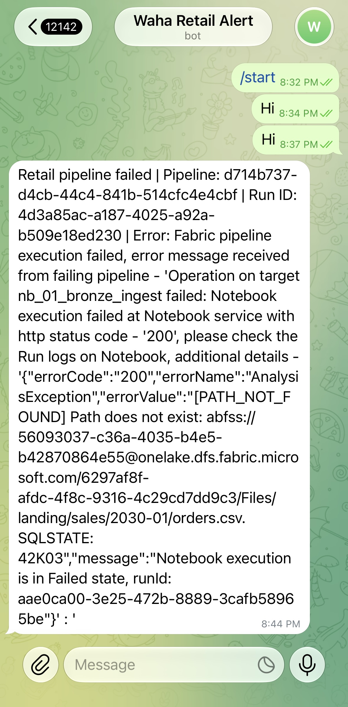
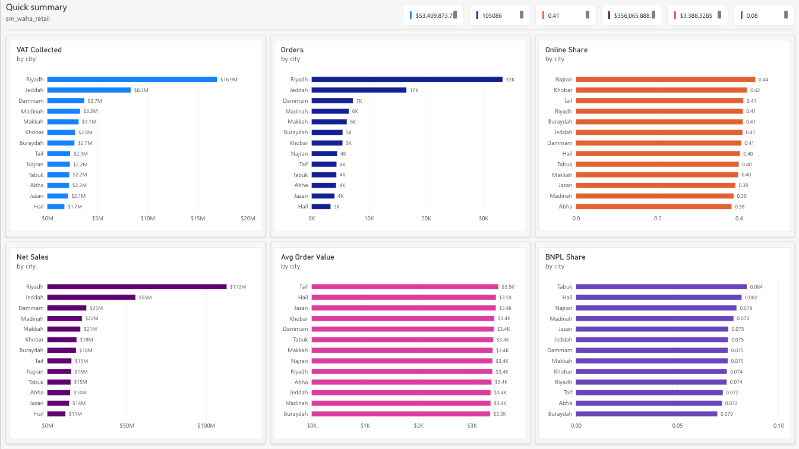

# Saudi Retail Sales Analytics on Microsoft Fabric

An end-to-end data engineering project on Microsoft Fabric. It loads a Saudi retailer's monthly sales automatically, cleans the data, models it into a star schema and feeds a Power BI dashboard. The dashboard compares the retailer's growth with real national card-spending data from the Saudi Central Bank (SAMA).



> **Data disclosure:** the retailer *Waha Retail* is fictional, and its sales data is generated by `scripts/generate_saudi_retail.py`. The market benchmark is **real** point-of-sale data published by SAMA.

---

## The business problem

Waha Retail runs 25 branches across Saudi cities and an online store. It sells electronics, clothing, furniture, food, jewelry and health products. Every month the finance team exports branch and online sales and merges them in Excel by hand. That is slow, error-prone and always late.

They asked for:

- a dashboard that updates itself when a new month arrives, sliceable by city, channel and payment method;
- the effect of Ramadan, White Friday and National Day on sales;
- an answer to one question: **are we growing faster or slower than the market?**

## Architecture

| Layer | Fabric item | What it does |
|---|---|---|
| Landing | Lakehouse `lh_retail` / Files | Raw monthly CSVs (orders, order items, payments), reference files and SAMA market data |
| Bronze | `nb_01_bronze_ingest` | Loads raw files as-is into Delta tables and adds audit columns (`_source_file`, `_ingested_at`, `_load_month`). Re-running a month replaces it, so there are no duplicates. |
| Silver | `nb_02_silver_transform` | Cleans, standardizes and de-duplicates. Incremental: watermark + Delta `MERGE`. |
| Gold | `nb_03_gold_model` | Star schema: two sales facts, a market fact, five dimensions and a benchmark table |
| Serving | `sm_waha_retail` (Direct Lake) → `pbi_waha_retail_report` | Semantic model and Power BI report |
| Orchestration | `pl_load_month`, `pl_monthly_sales`, `pl_backfill` | Data Factory pipelines with a Telegram failure alert |
| Lifecycle | Git integration + Fabric deployment pipeline | Branch → pull request → Dev → Prod |

## Data sources

**Retail sales (generated).** 36 months (Jan 2023 – Dec 2025), about 166,000 orders and 285,000 order lines, with fixed seed `2030` so every run gives the same data. The generator deliberately includes real-world problems: a byte order mark (BOM) in headers, city names in Arabic and English spellings, mixed timestamp formats, duplicate rows and late corrections.

**Market benchmark (real).** SAMA point-of-sale transactions by sector, monthly, 2016 to 2026:

- Jan 2024 onwards: SAMA Monthly Statistical Bulletin, sheet 30e;
- 2016 – 2023: SAMA report CSV (Arabic headers), originally found through the KAPSARC data portal.

`scripts/convert_sama_bulletin.py` merges both into one tidy file: `landing/market/pos_by_sector.csv`.

> **Caveat:** SAMA reclassified merchant sectors in January 2024, so some sectors jump at that month (Furniture about +25%, Health +16%, Jewelry +14%). Growth across that break is not like for like, and the report says so.

Market data credit: Saudi Central Bank (SAMA); KAPSARC Data Portal.

## Data model (gold)

| Table | Grain (one row is…) | Used for |
|---|---|---|
| `gold_fact_sales_lines` | one product line in an order | net sales, VAT, quantity by product, branch, city |
| `gold_fact_orders` | one order | payment methods, BNPL, channel, basket size |
| `gold_fact_market_monthly` | one month and category | SAMA card spending for that category's sector |
| `gold_dim_date` | one day | Saudi weekend (Fri–Sat), salary period, Ramadan, Eid, White Friday, National Day |
| `gold_dim_product`, `gold_dim_branch`, `gold_dim_customer`, `gold_dim_category` | one item each | slicing and filtering |

Every relationship is many-to-one with single-direction filtering. The market fact reaches products only through the category dimension, so one category slicer filters both the retailer's sales and SAMA's numbers.

## Design decisions

- **Index, not market share.** The retailer is a tiny fraction of national card spending, so a share would be a meaningless 0.00x%. Both series are indexed to 100 in the same month, which answers the real question: growing faster or slower than the market in each category?
- **Benchmark on net sales of delivered orders.** Cancelled and returned orders are not real spending, and VAT is excluded. SAMA's figures are card payments at physical terminals, so they are a proxy for the market, not an exact match.
- **Two sales facts at different grains.** Payment method and basket size belong to the order; products belong to lines. Putting the payment method on every line would count a 4-line order four times.
- **The Saudi calendar lives in `dim_date`.** Any visual can be sliced by weekend, salary period or event without hard-coded dates in DAX.
- **Explicit city map.** `الرياض`, `RIYADH` and `Riyadh City` become one city. A check fails the run if a new, unmapped spelling appears.
- **Timestamp format chosen per value.** A date like `05/07/2024` can never be read as May 7 instead of July 5.
- **Net and gross both stored.** Saudi finance teams report revenue excluding VAT, while payments include it. Keeping both makes the reconciliation possible.
- **BOM handled at read time**, so the first column name is never silently corrupted.
- **Market values converted from thousands of riyals once**, in silver, so no report has to remember the unit.
- **Event dates are approximate.** Islamic holidays follow moon sighting. Dates live in `events.csv`, so they can be corrected without touching code.

## Incremental loading

Silver processes only the rows that arrived since the last run, so run time stays flat as months accumulate.

1. **Watermark.** `etl_watermark` stores the latest `_ingested_at` processed per table. It moves forward only after a successful merge.
2. **Upsert.** New and changed rows go in with Delta `MERGE` on the business key.
3. **Scoped delete sync.** If a source system re-sends a month with rows removed, those rows are deleted from silver too. The delete is limited to the months in the current batch (`whenNotMatchedBySourceDelete` with a `_load_month IN (...)` condition), so older months are never touched.
4. **Reconciliation.** After every run, distinct keys in bronze are compared with rows in silver for each `_load_month`. Any mismatch raises an error and fails the pipeline.

Gold is rebuilt in full each run (about 170,000 orders, under a minute). At larger volumes the facts would switch to merges as well.

## Data quality checks

- VAT equals 15% of net sales (within rounding);
- payments match order totals;
- no unmapped city names;
- no duplicate business keys in silver;
- bronze and silver row counts reconcile per month.

<!-- Add the number of checks and a screenshot of the quality page here -->

## Orchestration

| Pipeline | Role |
|---|---|
| `pl_load_month` | Runs bronze → silver → gold for one `load_month` parameter |
| `pl_monthly_sales` | Scheduled monthly. Works out the month, invokes `pl_load_month` and sends a Telegram message if anything fails. |
| `pl_backfill` | Loops through a list of months in order (ForEach, sequential), invoking `pl_load_month` for each |

Each child pipeline is invoked with **Wait on completion** on, so a failure stops the run and triggers the alert.




## Dev → Prod and Git workflow

Changes flow through Git branches and pull requests, are promoted from Dev to Prod with a Fabric deployment pipeline, and every load is checked by data quality tests.

- The **Dev** workspace is connected to this repository (folder `fabric/`).
- New work is done in a **branch workspace** (Fabric "Branch out to workspace") with its own lakehouse. It is merged into `main` through a pull request.
- A **deployment pipeline** promotes items from Dev to Prod. Deployment rules point Prod notebooks at the Prod lakehouse.
- **Direct Lake note.** After deployment the Prod semantic model still pointed at the Dev lakehouse. It is rebound with semantic-link-labs (`update_direct_lake_model_lakehouse_connection`), followed by a refresh of the Prod SQL analytics endpoint.

## Repository layout

```
fabric-saudi-retail-analytics/
├── fabric/                       # Fabric items synced by Git integration
│   ├── nb_01_bronze_ingest.Notebook/
│   ├── nb_02_silver_transform.Notebook/
│   └── nb_03_gold_model.Notebook/
├── notebooks/                    # Readable .ipynb copies of the notebooks
├── scripts/
│   ├── generate_saudi_retail.py  # Generates the retail sales data
│   └── convert_sama_bulletin.py  # Merges SAMA bulletin + report into one CSV
├── tests/test_generator.py       # Tests for the generator
├── docs/
│   ├── architecture.png
│   └── screenshots/
├── pyproject.toml
└── README.md
```

## How to run it

**1. Generate the data (Mac / Linux)**

```bash
python3 -m venv .venv
source .venv/bin/activate
pip install pandas numpy openpyxl
python3 scripts/generate_saudi_retail.py
```

This writes `landing/sales/YYYY-MM/` and `landing/reference/`.

**2. Prepare the market data**

Download the SAMA monthly bulletin (Excel) and the 2016–2023 POS report (CSV), then run:

```bash
python3 scripts/convert_sama_bulletin.py <report.csv> <bulletin.xlsx>
```

**3. Set up Fabric**

1. Create a workspace and a Lakehouse named `lh_retail`.
2. Upload the `landing/` folder to the Lakehouse **Files** area.
3. Connect the workspace to this repository (Workspace settings → Git integration, folder `fabric/`), or import the notebooks from `notebooks/`.
4. Attach `lh_retail` as the default lakehouse in each notebook.

**4. Load and schedule**

1. Run `pl_backfill` once to load all available months.
2. Enable the schedule on `pl_monthly_sales`.
3. For alerts, create a Telegram bot and put its token in the Web activity. **Keep the real token out of Git**: the committed pipeline uses the placeholder `<TOKEN>`.

## Results

<!-- Fill in from your own runs. The data is generated, so frame findings as "what the dashboard shows", not market claims. -->

- Months loaded: …
- Orders / order lines processed: …
- Run time per month: …
- What the dashboard shows: Ramadan uplift …, online share …, categories ahead of the market index …



## Tech stack

Microsoft Fabric (Lakehouse, Notebooks, Data Factory pipelines, Deployment pipelines, Git integration) · PySpark · Delta Lake · Power BI (Direct Lake) · Python (pandas) · Telegram Bot API

## Author

Sarah Alqahtani · [LinkedIn](#) · [Upwork](#)
